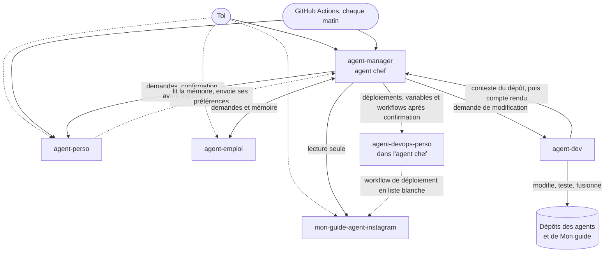

# Vue d'ensemble des agents

Qui fait quoi, qui appelle qui, et où s'arrête chaque agent. Ce document fait référence quand deux
README se contredisent. La fiche de cadrage détaillée de chaque agent est dans son propre dépôt
(`README.md`, et `CLAUDE.md` ou `PRINCIPES.md` pour ses règles non négociables).

Dernière mise à jour : 16 novembre 2026.

## Les agents

| Agent | Mission en une phrase | Tourne sur | Appelé par |
|---|---|---|---|
| [agent-manager](https://github.com/AnthonyStocko/agent-manager) (agent chef) | Être le point d'entrée unique : comprendre la demande, la confier au bon agent, retenir ce que les agents apprennent | Render | Toi ; GitHub Actions (point du matin) |
| [agent-perso](https://github.com/AnthonyStocko/agent-perso) | Tirer des mails ce qu'il y a à faire (agenda, tâches, planning), tenir les comptes communs, préparer des brouillons | Render | Toi ; l'agent chef ; GitHub Actions (traitement du matin) |
| [agent-emploi](https://github.com/AnthonyStocko/agent-emploi) | Chercher et noter les offres, rédiger CV et lettre, suivre les candidatures, entraîner aux entretiens | Render | Toi ; l'agent chef |
| [mon-guide-agent-instagram](https://github.com/AnthonyStocko/mon-guide-agent-instagram) | Préparer les publications et les commentaires du compte Instagram de Mon guide, sans rien publier sans ton accord | Supabase, GitHub Actions, Cloudflare | Toi (page d'administration) ; l'agent chef, en lecture seule |
| [agent-dev](https://github.com/AnthonyStocko/agent-dev) (agent développeur) | Modifier le code des autres agents, le tester et le fusionner si tout est vert | GitHub Actions | L'agent chef ; toi (onglet Actions) |
| [agent-devops-perso](https://github.com/AnthonyStocko/agent-devops-perso) (agent devops) | S'occuper de la mise en ligne : dire si ce qui est en ligne sur Render correspond au code, régler les variables d'environnement sur Render, lancer les workflows de déploiement autorisés sur GitHub | Dans l'agent chef, installé comme dépendance | L'agent chef |

Mon guide (dépôt `Monguide`) est l'application touristique, pas un agent : l'agent Instagram ne la touche
jamais, et agent-dev est le seul agent qui peut modifier son code.

## Qui appelle qui

Les flèches en pointillé sont les accès directs à l'interface de chaque agent, qui restent possibles.
Les agents ne s'appellent pas entre eux : tout passe par l'agent chef. Seuls agent-emploi et agent-perso (ce
qu'ils apprennent, pour la mémoire) et agent-dev (son compte rendu) lui écrivent en retour. L'agent devops ne
parle pas à l'agent Instagram : sur ordre de l'agent chef, il lance un workflow GitHub de son dépôt
(autorisé le 18 novembre 2026).

## Frontières

### L'agent chef orchestre, il ne fait pas le travail des autres

Ses missions propres sont au nombre de quatre : point d'entrée unique, mémoire commune, tableau de bord,
initiatives (point du matin). Le développement et le devops sont des agents à part, qu'il commande.

**Règle pour tout nouvel agent : un dépôt à lui.** Tant que la limite de services Render est atteinte,
l'agent chef l'installe comme dépendance et l'exécute dans son propre processus, comme l'agent devops.
Il sera hébergé à part quand un NAS sera disponible. « Crée un agent », dans la discussion de l'agent
chef, applique cette règle : création du dépôt (public), développement, puis installation dans l'agent
chef (voir le README, « Créer un nouvel agent »).

### Deux routines du matin, chacune sur son domaine

| Routine | Agent | Quand | Ce qu'elle fait |
|---|---|---|---|
| Traitement du matin | agent-perso | tous les jours, vers 7 h 15 | mails des dernières 24 heures, replanification des tâches, planning du jour, notification sur le téléphone |
| Point du matin | agent chef | du lundi au vendredi | recherche d'offres, notation, relances (par agent-emploi), traitement de la mémoire |

Elles sont volontairement séparées et ne s'appellent pas. Chacune est lancée par le workflow
`matin.yml` de son dépôt.

### Les mails : les alertes d'offres sont à agent-emploi

- **agent-emploi** lit, en lecture seule, les alertes d'offres : les mails des expéditeurs que tu as
  listés (`IMAP_SENDERS`), sur les derniers jours.
- **agent-perso** traite tout le reste de la boîte. Il ne tire ni tâche ni évènement d'une alerte d'offres :
  il laisse de côté les mails des expéditeurs listés dans sa variable `JOB_ALERT_SENDERS`, qui doit
  contenir la même liste que les expéditeurs d'alertes d'agent-emploi.
- Aucun des deux n'envoie de mail. La seule écriture dans la boîte est un brouillon déposé par agent-perso.

### La mémoire commune

Elle appartient à l'agent chef (base Postgres sur Neon, sauvegardée chaque nuit, chiffrée). Elle est
découpée en espaces (`memory.py`) :

| Espace | Catégories | Lu par | Écrit par |
|---|---|---|---|
| Commun | profil, préférences de travail, style d'écriture | tous les agents | tous les agents |
| Emploi | goûts en offres, récits d'expérience, points à travailler | agent-emploi | agent-emploi |
| Perso | habitudes d'organisation | agent-perso | agent-perso |
| Mon guide | ligne éditoriale | l'agent Instagram | l'agent Instagram |
| Dev | décisions techniques | agent-dev | agent-dev, agent devops |

L'agent chef lit tout et écrit partout, comme ta saisie manuelle. Un agent lit le commun et son espace
(`GET /agent/memory?espace=…`, avec `&q=…` pour n'avoir que les souvenirs utiles à un texte). Ses événements ne peuvent créer, modifier ou supprimer que des souvenirs
du commun et de son espace : le code refuse le reste, et le journal le note.

Branchés aujourd'hui : agent-emploi (il lit et alimente le commun et l'espace emploi), agent-dev et
agent-perso.
Au début de chaque travail, agent-dev demande à l'agent chef l'historique du dépôt visé et les décisions
techniques utiles (`GET /agent/dev/contexte`) ; ce contexte va seulement dans sa consigne, jamais sur
GitHub, car son dépôt est public. Ses comptes rendus alimentent l'espace dev. agent-perso lit le
commun et ses habitudes sans rien envoyer de la demande en cours, et ne transmet que les préférences que
tu énonces toi-même sur ta propre organisation : ni contenu de mail, ni données de tiers. L'espace
Mon guide attend que l'agent Instagram y soit branché.

Les données de tiers (contacts, rendez-vous avec d'autres personnes, dépenses) restent chez agent-perso :
elles n'ont pas de catégorie dans la mémoire commune. Rien de sensible n'y est retenu (santé, opinions,
origine, vie intime, données bancaires, identifiants) : le code le refuse, quelle que soit l'origine.

### Qui a le droit d'écrire où

| Agent | Écrit dans | N'écrit jamais dans |
|---|---|---|
| agent-perso | agenda, tâches et feuilles Google ; brouillons de mail | la boîte mail (ni envoi, ni déplacement, ni suppression) |
| agent-emploi | sa propre base (profil, offres, suivi) | la boîte mail |
| agent Instagram | son projet Supabase ; Instagram après ton « Approuver » | l'application Mon guide |
| agent-dev | les dépôts listés dans son `depots.json`, par pull request | `.github/` de chaque dépôt, les fichiers de règles protégés, son propre dépôt |
| agent-devops-perso | après ton « oui » : les variables d'environnement de réglage des agents sur Render (il lance ensuite le déploiement qui les applique) ; le lancement des workflows GitHub de sa liste blanche (aujourd'hui `deploy-supabase.yml` de l'agent Instagram), avec un jeton dédié | les secrets (mots de passe, jetons, clés), le reste de Render, le reste de GitHub (ni commit, ni workflow hors liste) |
| agent chef | sa mémoire ; il déclenche les autres agents | le code des agents (c'est le rôle d'agent-dev) |

## Modifier un agent

Toute modification de code passe par agent-dev (onglet Développeur ou discussion de l'agent chef), qui
lit d'abord le `README.md` et le `CLAUDE.md` ou `PRINCIPES.md` du dépôt visé. Ces fichiers de règles
sont protégés dans `depots.json` pour tous les agents : un travail qui les touche est rejeté en entier.
Élargir les droits d'un agent (une nouvelle écriture, par exemple) passe donc toujours par toi.
